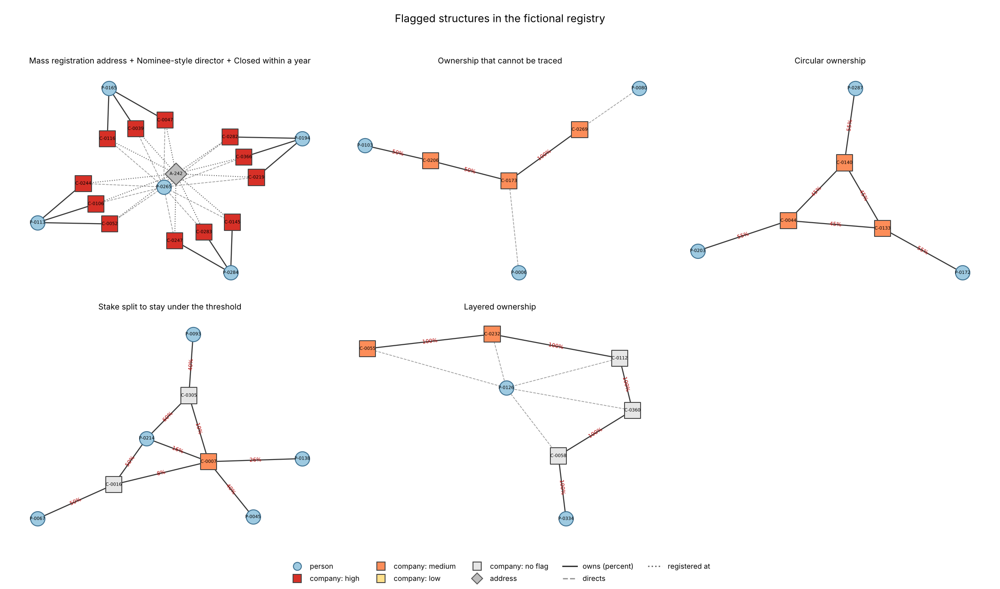

# OwnerLens

Find out who ultimately owns what in a company registry, and flag structures that deserve
a closer look: ownership loops, layers of shell companies, mass-registration addresses,
nominee-style directors and stakes split to stay under a reporting threshold.

> **Everything here is fictional.** The registry is generated by `ownerlens/generate.py`
> from word lists. The repository contains no real data and no code that collects data
> from any registry. See [Scope and responsible use](#scope-and-responsible-use).



## What it does

1. **Loads and validates** a registry of companies, people, addresses, ownership stakes
   and directors from five CSV files.
2. **Resolves ownership through layers.** If a person owns 50% of A and A owns 40% of B,
   they effectively own 20% of B. All routes are added up, and circular holdings are
   handled without looping.
3. **Applies seven red-flag rules** and gives each company a transparent score, with the
   evidence for every flag.
4. **Writes a findings report** (Markdown and CSV) and the picture above.

## Quickstart

You need Python 3 (tested on 3.13) and two packages. Run everything from the repository
root (on Windows use `py` if `python` is not found).

```bash
pip install -r requirements.txt

python -m ownerlens generate        # writes a fictional registry to data/registry
python -m ownerlens analyze         # writes reports/findings.md, findings.csv and the picture
python -m ownerlens owners C-0007   # who owns one company, route by route
python -m ownerlens evaluate        # measure detection against the planted structures
```

The generated data and the reports are already in the repository, so you can read
[`reports/findings.md`](reports/findings.md) without running anything.

### Example

`python -m ownerlens owners C-0007` shows a stake that is split to stay under the 25%
beneficial-owner line:

```
C-0007  Eastgate Group Inc
  P-0214 Pablo Walsh: 26.0%  <- beneficial owner
       16.0%  P-0214 > C-0007
        6.0%  P-0214 > C-0305 > C-0007
        4.0%  P-0214 > C-0016 > C-0007
  ...
score 25 (medium)
  - threshold_dodging: Pablo Walsh (P-0214) holds 26% through 3 routes, none above 16%
```

No single route is above 16%, yet together they reach 26%.

## The seven rules

| Code | Looks for | Default | Points |
|---|---|---|---|
| R1 | Companies that own each other in a loop | any loop | 30 |
| R2 | A beneficial owner whose closest route passes through many intermediary companies | 3 or more | 25 |
| R3 | Many companies registered at one address | 6 or more | 20 |
| R4 | One person directing many companies while owning almost none of them | 8 or more directorships, under 5% in at least 75% of them | 30 |
| R5 | A total stake of 25% or more reached only through routes that are each below 25% | 2 or more routes | 25 |
| R6 | Ownership that cannot be traced to a person | 25% or more (15 points), 50% or more (30 points) | 15 or 30 |
| R7 | Companies closed shortly after they were incorporated | 365 days or fewer | 20 |

Scores add up and are capped at 100. **High** is 50 or more, **medium** is 25 to 49, and
anything lower is **low**. Every threshold and weight is in
[`ownerlens/rules.py`](ownerlens/rules.py), and
[`docs/methodology.md`](docs/methodology.md) explains the reasoning, including an innocent
explanation for each rule.

## Results

The default registry has 372 companies, 379 people, 555 stakes and 412 directorships. It
contains 23 planted companies in seven structures, and 24 harmless lookalikes.

**Flags on the default registry:** 42 companies flagged: 12 high, 10 medium, 20 low.

| Planted structure | Rule | Found |
|---|---|---|
| Ring of three companies owning each other | R1 | 3 of 3 |
| Five-company chain to one person | R2 | 2 of 2 (the last two) |
| Twelve companies at one address | R3 | 12 of 12 |
| One director for all twelve, owning none | R4 | 12 of 12 |
| Five of those twelve closed within a year | R7 | 5 of 5 |
| 26% total split over three routes | R5 | 1 of 1 |
| Ownership ending in a company with no recorded owner | R6 | 5 of 5 |

**Repeated over 20 random backgrounds** (`python -m ownerlens evaluate`):

| Measure | Result |
|---|---|
| Planted companies that received their expected flag | 460 of 460 |
| Planted companies that reach medium or high | 440 of 460 |
| Companies that were not planted but reach medium or high | **0** |
| Harmless lookalikes (480) that reach medium or high | **0** |
| Harmless oddities flagged at low level | 93 |

How to read this: the planted structures were written to match the rules, so the 460 of
460 only shows that the generator and the rules agree. It is a sanity check, not a claim
about real registries. The informative lines are the zeros: ordinary companies, a
transparent corporate group at one address and a busy owner who directs ten companies
never rise above low. They do show up as low flags (the 93), which is the honest cost of
rules like "many companies at one address".

Twenty of the 460 planted companies stay at low level. They are the one company per
registry whose ownership is only 30% untraceable, which is worth 15 points on its own.

## Tests

```bash
pip install -r requirements-dev.txt
pytest
```

64 tests cover the loader and its error messages, the ownership arithmetic (chains,
several routes, the 25% boundary, loops, depth limit), the boundary of every rule (for
example 5 against 6 companies at an address, 7 against 8 directorships, 365 against 366
days), scoring, the generator (same seed gives identical files) and the whole pipeline
including the command line.

To check that the tests can actually fail, I broke the code in ten different ways, one
at a time (thresholds shifted by one, a boundary made strict, route shares not multiplied,
the loop guard removed, and others). The first run missed four. Two were real gaps, now
closed with new tests. One was a condition that turned out to be redundant, so I removed it
from the code and tested a different breakage in its place. The last one only loosens a
limit on chain depth inside the generator: at the default settings it never produces a deep
chain, and when I pushed it harder a test did catch it. The final run catches nine of the
ten.

## Project layout

```
ownerlens/
  registry.py    data model, CSV loading and validation
  ownership.py   graph, effective ownership, loops, untraceable share
  rules.py       the seven rules, scoring, levels
  report.py      Markdown and CSV findings, the network picture
  generate.py    the fictional registry and its ground truth
  evaluate.py    detection measured against what was planted
  cli.py         python -m ownerlens ...
data/            generated registry (CSV) and ground_truth.json
reports/         findings.md, findings.csv, evaluation.md, ownership_network.png
docs/            methodology.md
tests/
```

## Scope and responsible use

- OwnerLens is meant for **company-level due diligence**: understanding who owns and
  controls a legal entity.
- It ships with **no real data** and **no scrapers**. The data model deliberately keeps
  personal data to an id and a name per person.
- A flag is an **indicator**, not a finding. Each structure has innocent explanations and
  the tool cannot tell them apart.
- It is not a tool for building profiles of private individuals or families. If you point
  it at real records, use only sources you are lawfully allowed to use, stick to companies
  and public roles, and confirm every flag against the original documents.

## Design decisions

- **Plain Python and NetworkX.** Two dependencies (the second is Matplotlib, for the
  picture), no database, so it runs on any laptop.
- **CSV in, CSV and Markdown out.** Any registry export can be mapped onto five files.
- **Additive scores.** Fixed points per rule, so a score can be explained in one line.
- **Simple routes only.** A route may visit a company once, so circular holdings give a
  defined answer; the share lost in a loop is reported as untraceable, not guessed.
- **A deterministic generator that shuffles its ids.** The same seed always gives the same
  files, and the order of the ids does not reveal which companies were planted.

## Limitations

- Synthetic data only; no claim about accuracy on real registries.
- Percentage stakes only: no voting rights, trusts, nominee shareholders or bearer shares.
- One snapshot in time, apart from incorporation and dissolution dates.
- No name matching: one person under two spellings counts as two people.
- Thresholds and weights are judgement calls, not calibrated on real cases.
- Tested on Python 3.13 only.
